# Sistema de Gestión Bibliotecaria — SGB

Sistema de Gestión Bibliotecaria para la Universidad de Madeira, desarrollado con una **arquitectura por capas (N-Tier)** como proyecto académico de la asignatura Desarrollo de Software II.

## Información académica

- **Estudiante:** Manuel Morales Martínez
- **Código:** 406384
- **Institución:** Fundación Universitaria Católica Lumen Gentium — UNICATÓLICA
- **Asignatura:** Desarrollo de Software II
- **Evaluación:** Segundo Momento Evaluativo
- **Docente:** Fabian Stiven Valencia Córdoba

## Descripción del proyecto

El backend es una API REST desarrollada con Node.js y Express. Recibe solicitudes HTTP del frontend, coordina las reglas de aplicación y consulta o modifica la información mediante repositorios conectados a PostgreSQL en Supabase. Los datos se envían al cliente en formato JSON; la API no sirve páginas HTML.

El sistema de demostración incluye catálogo de recursos, usuarios de ejemplo, préstamos, reservas, renovaciones, devoluciones, multas y actividades con inscripción.

## Arquitectura por capas (N-Tier)

La separación por capas delimita responsabilidades, reduce el acoplamiento y facilita el mantenimiento, las pruebas y la evolución del sistema. Se basa en el patrón descrito en *Fundamentals of Software Architecture*, de Mark Richards y Neal Ford: cada capa mantiene una responsabilidad definida y se comunica con las capas adyacentes.

1. **Presentación — frontend y API:** la interfaz React presenta la información. En el backend, Express y los controladores reciben solicitudes HTTP y generan respuestas.
2. **Lógica de aplicación — servicios:** coordina los casos de uso y las reglas del dominio.
3. **Persistencia — repositorios:** encapsula las consultas SQL y el acceso a los datos.
4. **Base de datos — Supabase PostgreSQL:** almacena recursos, usuarios, préstamos, reservas, multas y actividades.

Esta división permite cambiar la interfaz sin trasladar las consultas SQL, y modificar la persistencia sin llevar esa lógica a los controladores.

## Flujo end-to-end: consulta de recursos

1. El frontend solicita `GET /api/recursos` vía HTTP.
2. Express dirige la solicitud al controlador de recursos.
3. El controlador delega la operación a `recursoService`.
4. El servicio solicita los registros a `recursoRepository`.
5. El repositorio consulta PostgreSQL mediante el pooler de Supabase.
6. Los registros regresan del repositorio al servicio y al controlador.
7. El controlador responde con **`200 OK`** y un JSON estandarizado. La API devuelve datos, no HTML.

Ejemplo de respuesta:

```json
{
  "success": true,
  "data": [
    {
      "id": 1,
      "titulo": "Ejemplo de recurso",
      "autor": "Autor de ejemplo",
      "coleccion": "General",
      "ejemplares": 2,
      "estado": "Disponible"
    }
  ]
}
```

## Diagrama de arquitectura

[Abrir el editor Mermaid Live](https://mermaid.live/) · [Ver el diagrama compartido](https://mermaid.ai/d/16789ce8-6554-427d-917e-ce4389f31fb5)

El siguiente diagrama documenta la arquitectura implementada: presentación, proxy HTTP, rutas y controladores, servicios, repositorios, transacciones, tablas PostgreSQL y despliegue Docker. Puedes copiar el código al editor Mermaid Live para visualizarlo o exportarlo.

```mermaid
flowchart LR
    subgraph Presentation["Presentación - navegador"]
        Pages["React pages: Portal, Estudiante, Dashboard, Recursos, Usuarios, Prestamos, Multas, Actividades"]
        ClientServices["TypeScript services + Axios"]
        Pages --> ClientServices
    end

    subgraph Delivery["Entrega y transporte HTTP"]
        Vite["Desarrollo: Vite proxy /api"]
        Nginx["Produccion: Nginx proxy /api"]
        ApiRoutes["Express REST routes /api/*"]
        ClientServices -->|"HTTP JSON"| Vite
        ClientServices -->|"HTTP JSON"| Nginx
        Vite --> ApiRoutes
        Nginx --> ApiRoutes
    end

    subgraph Application["Backend - Node.js y Express"]
        ResourceController["RecursoController"]
        UserController["UsuarioController"]
        LoanController["PrestamoController"]
        FineController["MultaController"]
        EventController["ActividadController"]
        ResourceService["RecursoService"]
        UserService["UsuarioService"]
        LoanService["PrestamoService"]
        FineService["MultaService"]
        EventService["ActividadService"]
        ApiRoutes --> ResourceController
        ApiRoutes --> UserController
        ApiRoutes --> LoanController
        ApiRoutes --> FineController
        ApiRoutes --> EventController
        ResourceController --> ResourceService
        UserController --> UserService
        LoanController --> LoanService
        FineController --> FineService
        EventController --> EventService
    end

    subgraph Persistence["Persistencia - repositorios PostgreSQL"]
        ResourceRepository["RecursoRepository"]
        UserRepository["UsuarioRepository"]
        LoanRepository["PrestamoRepository"]
        FineRepository["MultaRepository"]
        EventRepository["ActividadRepository"]
        Transactions["transaction.js: transacciones atomicas"]
        ResourceService --> ResourceRepository
        UserService --> UserRepository
        LoanService --> LoanRepository
        FineService --> FineRepository
        EventService --> EventRepository
        LoanRepository --> Transactions
        EventRepository --> Transactions
        ResourceRepository -.->|registros| ResourceService
        UserRepository -.->|registros| UserService
        LoanRepository -.->|registros| LoanService
        FineRepository -.->|registros| FineService
        EventRepository -.->|registros| EventService
        ResourceService -.-> ResourceController
        UserService -.-> UserController
        LoanService -.-> LoanController
        FineService -.-> FineController
        EventService -.-> EventController
        ResourceController -.-> ApiRoutes
        UserController -.-> ApiRoutes
        LoanController -.-> ApiRoutes
        FineController -.-> ApiRoutes
        EventController -.-> ApiRoutes
    end

    subgraph Data["Base de datos Supabase PostgreSQL"]
        DB[("Supabase")]
        Tables["recursos, usuarios, prestamos, reservas, multas, actividades, inscripciones_actividades"]
        DB --> Tables
        ResourceRepository --> DB
        UserRepository --> DB
        LoanRepository --> DB
        FineRepository --> DB
        EventRepository --> DB
        Transactions --> DB
    end

    subgraph Deployment["Despliegue Docker"]
        FrontendContainer["Contenedor frontend: Vite dev o Nginx produccion"]
        BackendContainer["Contenedor backend: Node.js / Express"]
        FrontendContainer -->|"red Docker: HTTP backend:3000"| BackendContainer
        BackendContainer -->|"TLS: Session Pooler"| DB
    end

    ApiRoutes -.->|"respuesta JSON; p. ej. 200 OK"| ClientServices
    Vite -.->|"HTML/JS/CSS servido aparte; no por la API"| Pages
    Nginx -.->|"HTML/JS/CSS servido aparte; no por la API"| Pages
```



El diagrama representa los componentes y flujos implementados en este proyecto; no pretende enumerar todos los patrones ni contenidos del libro de referencia.

## Funcionalidades

- Consultar y registrar recursos bibliográficos.
- Consultar estudiantes y usuarios; registrar usuarios.
- Registrar préstamos asociados al usuario y bibliotecario; el estudiante puede apartar un ejemplar disponible de Colección General durante 48 horas para recogerlo en biblioteca.
- Renovar préstamos únicamente dentro del límite de cada colección y sin mora, multas pendientes o reservas en espera.
- Devolver préstamos; la cola FIFO de General y tabletas Tecnoteca asigna apartados de 48 horas y omite usuarios bloqueados.
- Consultar y cancelar apartados y reservas en lista de espera; los apartados vencidos liberan el ejemplar automáticamente.
- Registrar multas manuales y generar cargos diarios idempotentes por préstamos vencidos; las multas pendientes bloquean préstamos, reservas y renovaciones.
- Cambiar los estados de recursos desde el catálogo; los flujos de circulación sincronizan disponibilidad, préstamo y apartado.
- Publicar actividades e inscribir usuarios respetando los cupos.
- Iniciar sesión con JWT y proteger las operaciones por rol; los préstamos y reservas se bloquean si hay multas pendientes.
- Validar los campos y mínimos de inventario de cada colección; la Mapoteca se presta por USB en modo de lectura.

### Reglas de inventario y préstamo

| Colección/tipo | Mínimo de ejemplares | Plazo | Renovaciones | Datos específicos |
|---|---:|---:|---:|---|
| General | 5 por registro | 15 días | 5 | Apartado web para recoger en 48 horas; ISBN, resumen, autores, publicación, dimensiones y encuadernación |
| Reserva | 10 por registro | 5 días | 0 | Los mismos datos bibliográficos de los libros |
| Referencia | 3 | 3 días | 2 | Medidas en pulgadas |
| Hemeroteca | 2 | 1 día | 1 | ISSN y periodicidad |
| Mapoteca | No aplica | 1 día, hasta las 21:00 | 0 | Formatos JPG, PDF, Shape o DWG; USB de solo lectura |
| Tecnoteca: laptop | 3 | 7 días | 2 | Número, marca, modelo, cargador y funda |
| Tecnoteca: tableta | 10 | 7 días | 2 | Número, marca, modelo, cargador y funda |

El inventario almacena por separado los ejemplares disponibles y el total registrado, así los préstamos no reducen el mínimo histórico.

## API disponible

La dirección local del backend es `http://localhost:3000`.

| Método | Ruta | Descripción |
|---|---|---|
| `POST` | `/api/auth/login` | Iniciar sesión y obtener un JWT |
| `GET` | `/api/auth/me` | Consultar el perfil autenticado |
| `GET` | `/api/recursos` | Consultar el catálogo (público) |
| `POST` | `/api/recursos` | Registrar recursos (Bibliotecario) |
| `PATCH` | `/api/recursos/:id/estado` | Cambiar estado de un recurso (Bibliotecario) |
| `GET` | `/api/usuarios` | Consultar usuarios (Bibliotecario) |
| `GET` | `/api/usuarios/estudiantes` | Consultar estudiantes (Bibliotecario) |
| `POST` | `/api/usuarios` | Crear usuario y contraseña inicial (Bibliotecario) |
| `GET` | `/api/prestamos` | Consultar préstamos activos propios o todos (Bibliotecario) |
| `GET` | `/api/prestamos/todos` | Consultar préstamos propios o todos (Bibliotecario) |
| `POST` | `/api/prestamos` | Registrar préstamo para un usuario (Bibliotecario) |
| `PATCH` | `/api/prestamos/:id/renovar` | Renovar un préstamo propio o de cualquier usuario (Bibliotecario) |
| `PATCH` | `/api/prestamos/:id/devolver` | Devolver un préstamo (Bibliotecario) |
| `GET` | `/api/reservas` | Consultar reservas propias o todas (Bibliotecario) |
| `POST` | `/api/reservas` | Apartar un ejemplar disponible de General o entrar en lista de espera (Estudiante/Profesor) |
| `DELETE` | `/api/reservas/:id` | Cancelar reserva propia (o cualquier reserva como Bibliotecario) |
| `GET` | `/api/multas` | Consultar multas propias o todas (Bibliotecario) |
| `POST` | `/api/multas` | Registrar multa (Bibliotecario) |
| `PATCH` | `/api/multas/:id/pagar` | Marcar una multa como pagada (Bibliotecario) |
| `GET` | `/api/actividades` | Consultar actividades (usuario autenticado) |
| `POST` | `/api/actividades` | Crear una actividad (Bibliotecario) |
| `POST` | `/api/actividades/:id/inscripciones` | Inscribirse (Estudiante) |

Las respuestas correctas de lectura siguen el formato `{ "success": true, "data": ... }`. En las operaciones de creación el servidor puede responder `201 Created`; las validaciones incorrectas responden con un estado de error y un mensaje JSON.

Las rutas protegidas requieren `Authorization: Bearer <JWT>`. Una solicitud no autenticada responde `401`; una operación no permitida para el rol responde `403`. Los tokens expiran a las 8 horas.

### Cuentas semilla y configuración

La inicialización mantiene un mínimo de 50 estudiantes, 10 profesores y 3 bibliotecarios, y registra recursos de ejemplo en las colecciones. En desarrollo, las cuentas semilla usan la contraseña `Demo123!`; el acceso bibliotecario inicial es `lucia.demo@example.test`. La cuenta `valeria.demo@example.test` tiene una multa pendiente de ejemplo para validar el bloqueo por mora.

Para establecer la contraseña de las cuentas semilla, define `DEMO_USER_PASSWORD` antes del primer inicio del backend. En producción, configura además un `JWT_SECRET` aleatorio de al menos 32 bytes. Los valores predeterminados solo se permiten en desarrollo local.

### Preparar el esquema de Supabase

El backend usa PostgreSQL en Supabase. Ejecuta [`supabase/setup.sql`](./supabase/setup.sql) en el **SQL Editor** para crear las tablas, índices y datos semilla. Si la base ya estaba configurada, ejecuta también [`supabase/migrations/20261112_reservas_apartados.sql`](./supabase/migrations/20261112_reservas_apartados.sql) para agregar el estado y vencimiento de los apartados sin borrar las reservas existentes. No migra datos del archivo local anterior; el cambio comienza con el catálogo semilla.

Para registrar multas diarias sin duplicarlas, ejecuta asimismo [`supabase/migrations/20261112_multas_mora_por_prestamo.sql`](./supabase/migrations/20261112_multas_mora_por_prestamo.sql) en bases existentes. La configuración `OVERDUE_FINE_DAILY_RATE` establece la tarifa por día en pesos COP y usa `2000` si no se define. El backend marca préstamos vencidos cada minuto y revisa las multas de mora diariamente; las multas se registran por préstamo y día para que las reejecuciones sean idempotentes.

Usa el **Session Pooler** de Supabase, apropiado para el backend Express persistente. Copia [`.env.example`](./.env.example) a `.env`, descarga el certificado CA desde **Database Settings → SSL Configuration** de Supabase y guárdalo como `certs/prod-ca-2021.crt`. Luego completa `DATABASE_URL`, `DEMO_USER_PASSWORD`, `JWT_SECRET` y deja `PG_CA_CERT_PATH=./certs/prod-ca-2021.crt`. El backend valida TLS y el certificado del servidor, revisa que exista el esquema y crea los hashes bcrypt de las cuentas semilla que aún no tengan contraseña. Nunca publiques ni compartas `.env`, contraseñas o claves; la URL de PostgreSQL es privada y solo se usa en el backend. No uses `anon` ni `service_role` en el frontend.

### Despliegue del backend en Render

El archivo [`render.yaml`](./render.yaml) prepara un servicio Node con `npm ci`, `npm start` y la comprobación de salud `/health`. Conecta Render al repositorio `Sgb-Backend` y crea el servicio usando el Blueprint detectado. Si lo configuras manualmente, usa la raíz del repositorio como **Root Directory**, con esos mismos comandos.

En Render configura estas variables:

| Variable | Valor |
|---|---|
| `DATABASE_URL` | URL nueva del **Session Pooler** de Supabase. Mantén esta credencial únicamente en Render. |
| `DEMO_USER_PASSWORD` | Contraseña inicial larga y única; solo se aplica a cuentas semilla que aún no tengan hash. |
| `OVERDUE_FINE_DAILY_RATE` | Tarifa entera en pesos COP por cada día de mora (por defecto `2000`). |
| `JWT_SECRET` | Render la genera mediante el Blueprint; conserva el valor y no lo compartas. |
| `CORS_ORIGINS` | Añádela después de crear el frontend: el origen de Vercel, por ejemplo `https://tu-proyecto.vercel.app` (sin `/` final). Se pueden separar varios orígenes con comas. |
| `NODE_ENV` | `production`; queda configurada por el Blueprint. |

Render puede desplegar inicialmente sin `CORS_ORIGINS`; mientras esté vacía, el navegador no podrá invocar la API desde otro origen. Cuando Vercel asigne el dominio, agrega `CORS_ORIGINS` en Render y vuelve a desplegar. `/health` comprueba la conexión a PostgreSQL y Render lo usa para detectar si la API está disponible. Si Supabase requiere un CA personalizado, cárgalo como Secret File en Render y establece `PG_CA_CERT_PATH` con su ruta; deja esa variable sin configurar si la validación TLS funciona con los certificados del sistema.

Antes de hacer público el servicio, restablece la contraseña de la base de datos de Supabase si alguna vez fue compartida, y cambia o elimina las cuentas y contraseñas semilla de prueba. `DEMO_USER_PASSWORD` no sustituye hashes que ya existan. El plan gratuito de Render puede suspender el servicio por inactividad, por lo que la primera solicitud puede tardar en responder.

## Requisitos

- Docker y Docker Compose para ejecutar el sistema completo.
- Node.js 22 o superior y npm si se ejecutan los servicios directamente en el equipo.

## Ejecución con Docker Compose

Clona los dos repositorios dentro de la carpeta contenedora para que queden como directorios hermanos:

```bash
mkdir SGB-Universidad-Madeira
cd SGB-Universidad-Madeira
git clone https://github.com/GMort01/Sgb-Backend.git sgb-backend
git clone https://github.com/GMort01/Sgb-Frontend.git sgb-frontend
```

Los archivos Compose unificados están en el repositorio backend. Desde la carpeta contenedora, entra en `sgb-backend` y levanta el entorno de **producción**:

```bash
cd sgb-backend
```

Antes de iniciar, copia `.env.example` a `.env` (en PowerShell: `Copy-Item .env.example .env`) y completa `DATABASE_URL`, `DEMO_USER_PASSWORD` y `JWT_SECRET`.

```bash
docker compose up --build
```

El Compose predeterminado construye y levanta frontend y backend:

- **Backend:** `http://localhost:3000`
- **Frontend:** `http://localhost:5173`

Para usar el entorno de **desarrollo** en su lugar:

```bash
docker compose -f docker-compose.dev.yml up --build
```

Para detener producción:

```bash
docker compose down
```

Si iniciaste desarrollo, detén ese perfil con:

```bash
docker compose -f docker-compose.dev.yml down
```

En producción, Nginx sirve la interfaz y reenvía `/api` al backend por la red interna. En ambos modos, el backend conecta con Supabase mediante TLS, dispone de un healthcheck y el frontend espera a que la API esté saludable.

### Archivos Docker

- `Dockerfile`: imagen de producción del backend.
- `Dockerfile.dev`: imagen de desarrollo del backend.
- `docker-compose.yml`: despliegue unificado de producción; construye `.` como backend y `../sgb-frontend` como frontend.
- `docker-compose.dev.yml`: despliegue unificado de desarrollo con los mismos dos repositorios hermanos.
- `docker-compose.backend.yml` y `docker-compose.backend.dev.yml`: opciones para ejecutar únicamente el backend.
- `sgb-frontend/Dockerfile` y `sgb-frontend/Dockerfile.dev`: imágenes de producción y desarrollo del frontend.
- `sgb-frontend/docker-compose.yml` y `sgb-frontend/docker-compose.dev.yml`: frontend independiente, conectado a la red Docker `sgb-network`.

Los Compose unificados requieren que ambos repositorios estén en carpetas hermanas llamadas `sgb-backend` y `sgb-frontend`. No levantes simultáneamente stacks distintos que publiquen los mismos puertos.

## Ejecución local del backend

Desde la carpeta `sgb-backend`:

```bash
npm install
npm run dev
```

La API quedará disponible en `http://localhost:3000`. Para consultar el catálogo, abre `http://localhost:3000/api/recursos`.

La conexión a Supabase se configura en `DATABASE_URL` dentro de `.env`. No configures la URL en el frontend. Para ejecutar las pruebas de aceptación (`sprint1.test.js` y `sprint2.test.js`) contra una base aislada, define `TEST_DATABASE_URL` con una base desechable que ya tenga aplicadas las migraciones; nunca apuntes la prueba a producción.

## Estructura del backend

```text
sgb-backend/
├── src/
│   ├── config/          # Pool de conexión y validación de Supabase
│   ├── controllers/     # Controladores HTTP y respuestas de la API
│   ├── repositories/    # Consultas SQL y persistencia
│   ├── services/        # Casos de uso y lógica de aplicación
│   ├── app.js           # Configuración Express y rutas
│   └── ...
├── Dockerfile
├── Dockerfile.dev
├── .env.example
├── docker-compose.yml
├── docker-compose.dev.yml
├── docker-compose.backend.yml
├── docker-compose.backend.dev.yml
└── README.md
```

## Verificación rápida

Con el backend iniciado, comprueba el endpoint principal:

```bash
curl http://localhost:3000/api/recursos
```

La primera inicialización de una base vacía agrega datos ficticios de ejemplo y prepara las tablas necesarias. Las migraciones actuales preservan los datos existentes.

## Alcance de seguridad

La API protege las operaciones según el rol y almacena las contraseñas con hash bcrypt; el frontend mantiene el JWT en almacenamiento de sesión. El proyecto sigue siendo una aplicación académica: usa credenciales y datos ficticios, define secretos seguros por entorno y no reutilices las contraseñas semilla en producción.
